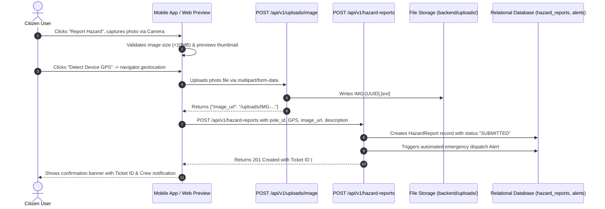

# PoleGuard Real Database-Backed Authentication Architecture

This document details the genuine, database-backed authentication, security rules, role-based access control (RBAC), and photo hazard reporting workflows across the **PoleGuard AI & IoT Life Safety Platform**.

---

## 1. Authentication Architecture Overview

PoleGuard strictly rejects hardcoded credentials or mock user personas in production and preview interfaces. Every authentication action communicates directly with the FastAPI backend and persists records in the relational database (**PostgreSQL** in production, **SQLite + aiosqlite** in local development).

```mermaid
sequenceDiagram
    autonumber
    actor User as User (Mobile / Web Preview)
    participant UI as Flutter App / index.html
    participant API as FastAPI Backend (/api/v1/auth)
    participant DB as Relational Database (users, audit_logs)

    Note over User,DB: Sign Up (Registration) Flow
    User->>UI: Enters Name, Email, Password, Role (+ Staff Key if applicable)
    UI->>API: POST /api/v1/auth/register
    API->>DB: Check if email exists
    alt Email already exists
        API-->>UI: 400 Bad Request ("An account with this email already exists.")
        UI-->>User: Displays error banner; keeps user on form
    else Staff role without valid key
        API-->>UI: 403 Forbidden ("Invalid department authorization code...")
        UI-->>User: Displays key requirement error
    else Valid Registration
        API->>API: Hash password via PBKDF2-SHA256 (salt + rounds)
        API->>DB: Insert User record (id, email, hashed_password, full_name, role)
        API->>DB: Record AuditLog ("USER_REGISTERED")
        API->>API: Generate signed JWT Bearer Access Token
        API-->>UI: 201 Created (access_token, user object)
        UI->>UI: Save JWT in secure storage & set currentUser
        UI-->>User: Displays "Welcome, [User's Real Name]" Dashboard
    end

    Note over User,DB: Sign In (Login) Flow
    User->>UI: Enters Email & Password
    UI->>API: POST /api/v1/auth/login
    API->>DB: Fetch user by email
    alt User not found OR Password hash mismatch
        API-->>UI: 401 Unauthorized ("Incorrect email or password.")
        UI-->>User: Displays red warning; strictly blocks dashboard access
    else Password valid
        API->>DB: Record AuditLog ("USER_LOGIN")
        API->>API: Generate signed JWT Bearer Token
        API-->>UI: 200 OK (access_token, user object)
        UI->>UI: Save JWT token & update UI state
        UI-->>User: Redirects to assigned Role Dashboard with user name
    end
```

---

## 2. API Endpoints Reference

### 2.1 User Registration
- **Endpoint**: `POST /api/v1/auth/register`
- **Request Body**:
  ```json
  {
    "email": "citizen.user@example.com",
    "password": "SecurePassword123",
    "full_name": "Snehal Chavan",
    "role": "CITIZEN",
    "phone": "+91 9876543210",
    "staff_auth_code": null
  }
  ```
- **Validation Rules**:
  - Email format checked via RFC 5322 regex.
  - Password minimum length >= 6 characters.
  - Email uniqueness: returns `400 Bad Request` if duplicate.
  - Staff Key Gate: roles `TECHNICIAN`, `ENGINEER`, `AUTHORITY`, and `ADMIN` require `staff_auth_code` matching `POLEGUARD-SECURE-2026`. Failure returns `403 Forbidden`.
- **Response** (`201 Created`):
  ```json
  {
    "access_token": "eyJhbGciOiJIUzI1NiIsIn...",
    "token_type": "bearer",
    "user": {
      "id": "USR-A1B2C3D4",
      "email": "citizen.user@example.com",
      "full_name": "Snehal Chavan",
      "role": "CITIZEN",
      "is_active": true,
      "zone": "Sector 4"
    }
  }
  ```

### 2.2 User Login
- **Endpoint**: `POST /api/v1/auth/login`
- **Request Body**:
  ```json
  {
    "email": "citizen.user@example.com",
    "password": "SecurePassword123"
  }
  ```
- **Behavior**:
  - Queries `users` table for matching email.
  - Verifies password against PBKDF2-SHA256 hash using `passlib.context.CryptContext`.
  - **Wrong password or nonexistent email**: returns `401 Unauthorized` with detail `"Incorrect email or password."`. The frontend displays a persistent red alert banner and never advances to any dashboard.
  - **Success**: returns `200 OK` with signed JWT token and user details.

### 2.3 Password Reset Lifecycle
- **Step 1: Request Reset Token**:
  - `POST /api/v1/auth/forgot-password`
  - Body: `{"email": "user@example.com"}`
  - Generates secure cryptographic UUID token stored in `password_resets` table with 1-hour expiration timestamp.
- **Step 2: Submit New Password**:
  - `POST /api/v1/auth/reset-password`
  - Body: `{"token": "PR-...", "new_password": "NewSecretPassword456"}`
  - Validates token existence and expiry, hashes new password, updates user record, and invalidates token.

---

## 3. Real Citizen Hazard Photo & GPS Reporting

PoleGuard citizens can take photos using their phone camera or select from their gallery to report electrical hazards.



- **Photo Upload Endpoint**: `POST /api/v1/uploads/image`
  - Accepts `multipart/form-data` with key `file`.
  - Allowed MIME types: `.jpg`, `.jpeg`, `.png`, `.webp`.
  - Maximum size: 10 MB.
  - Generates collision-proof filename `IMG-[UUID].[ext]` in `backend/uploads/`.
- **Hazard Report Submission**: `POST /api/v1/hazard-reports`
  - Body fields: `pole_id`, `latitude`, `longitude`, `hazard_type`, `description`, `image_url`, `reporter_name`, `reporter_phone`.
  - Status lifecycle: `SUBMITTED` -> `UNDER_REVIEW` -> `ASSIGNED` -> `IN_PROGRESS` -> `RESOLVED`.

---

## 4. Role-Based Access Control (RBAC) Matrix

| Role | Permitted Actions | Restricted Actions |
| :--- | :--- | :--- |
| **CITIZEN** | Report hazards with camera photos, detect live GPS, query statutory safety RAG chatbot, view local pole safety status, trigger SOS. | Cannot view technician work orders, SCADA cutoff switches, or admin user management (HTTP 403). |
| **TECHNICIAN** | View assigned repair work orders, monitor 24h leakage charts, update job status (`IN_PROGRESS`, `RESOLVED`), record earth pit resistance. | Cannot create new staff accounts or order remote grid de-energization. |
| **ENGINEER** | Monitor division fleet reliability, inspect AI model inference weights, assign hazard tickets to field linemen. | Cannot override executive municipal disaster escalations. |
| **AUTHORITY** | Metropolitan safety index overview, view active disaster escalations, execute emergency remote grid cutoff. | Routine field work order checklists. |
| **ADMIN** | User management, audit logs, system diagnostic scenario injection, platform configuration. | Full platform administrative oversight. |

---

## 5. Verification & Testing Instructions

### Automated Verification
Run the backend test suite to verify 100% database authentication compliance:
```bash
# Run the dedicated real authentication test suite
pytest tests/backend/test_real_auth.py -v

# Run the complete test suite across all modules (68 tests)
pytest
```

### Manual Testing in Web Preview
1. Start the FastAPI backend:
   ```bash
   run.bat
   # or
   uvicorn backend.main:app --reload --port 8000
   ```
2. Open `index.html` or `app_preview.html` in any browser:
   - Click **Create Account**.
   - Register a real user:
     - Full Name: `Snehal Chavan`
     - Email: `snehal@testdomain.com`
     - Password: `Password123`
     - Confirm Password: `Password123`
     - Role: `Citizen`
   - Click **Create Account & Sign In**. Notice the app bar displays **"Welcome, Snehal Chavan"** and avatar **S**.
3. Test Negative Authentication (Wrong Password):
   - Click **Logout**.
   - Enter `snehal@testdomain.com` with a wrong password: `WrongPassword999`.
   - Click **Sign In**.
   - Verify: The red error banner displays **"Incorrect email or password."** and you are strictly blocked from accessing any dashboard.
4. Test Valid Login:
   - Enter `Password123`.
   - Click **Sign In**.
   - Verify: Dashboard opens immediately with authenticated profile.
