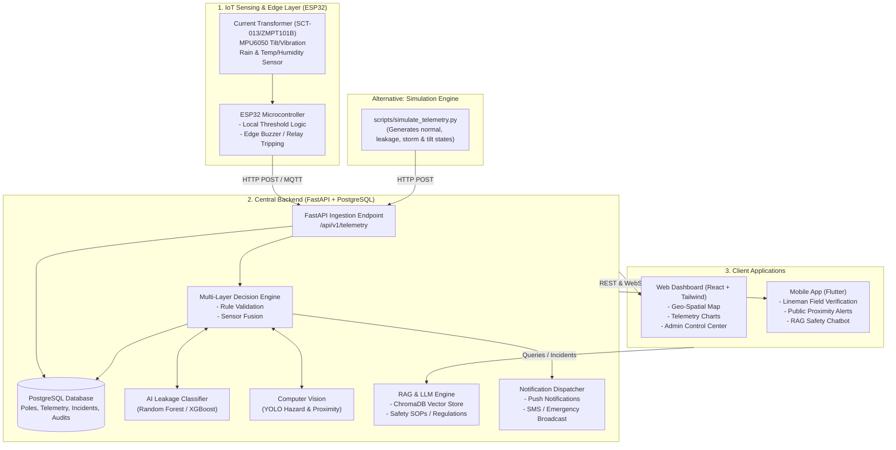

# AI and IoT Based Leakage Detection in Electric Pole and Life Safety

[](https://opensource.org/licenses/MIT)
[](https://fastapi.tiangolo.com)
[](https://www.postgresql.org)
[](https://reactjs.org)
[](https://flutter.dev)
[](https://www.espressif.com/en/products/socs/esp32)
[](https://github.com/ultralytics/ultralytics)

---

## 1. Project Problem Statement

In urban and rural electricity distribution networks, utility and street light poles frequently develop hazardous electrical faults. These faults are exacerbated during heavy rain, high humidity, flash floods, or physical damage (such as vehicular collisions, falling branches, or insulation aging).

### Key Challenges
* **Public Electrocution Hazards:** Uninsulated metal poles, rusted earthing connections, and submerged wiring introduce touch/step potential in standing water, leading to tragic deaths and injuries of pedestrians, children, and animals.
* **Absence of Real-Time Visibility:** Power utilities rely on manual citizen complaints or catastrophic breaker trips. Low-current leakages (15mA to 100mA) often persist beneath circuit-breaker thresholds, turning poles into silent death traps without tripping substation relays.
* **Delayed Emergency Response:** Linemen lack precise situational awareness, geo-location data, and historical hazard records before deploying into flooded zones.
* **Lack of Citizen Warning:** Pedestrians near waterlogged poles have no warning indicators or safety broadcasts when approaching high-voltage hazard perimeters.

---

## 2. Proposed Solution

The **AI & IoT Based Leakage Detection in Electric Pole and Life Safety Platform** is a proactive, multi-tier cyber-physical safety network. It combines smart edge hardware, computer vision, machine learning, and retrieval-augmented intelligence to detect, classify, isolate, and warn against electrical leakage in real time.

### Core Capabilities
1. **IoT Edge Sensing:** ESP32-based sensor clusters mounted on utility poles measuring leakage current, structure tilt/displacement, ambient vibration, rain intensity, and temperature.
2. **Fail-Safe Edge Alerts:** Instantaneous local acoustic and visual sirens (buzzer + high-visibility strobe) triggered locally even if cloud network connectivity drops.
3. **Unified Ingestion & Storage:** High-throughput FastAPI ingestion engine feeding PostgreSQL for telemetry, alert lifecycle logs, and maintenance audits.
4. **AI & Machine Learning Risk Engine:** Tabular ML (Random Forest / XGBoost) trained to classify multi-parameter sensor patterns into 4 hazard tiers (Normal, Advisory, High Risk, Critical Emergency).
5. **Computer Vision (YOLO):** Automated visual inspection identifying waterlogging at pole bases, structural wire drooping, and human proximity within hazard perimeters.
6. **Multi-Source Decision Engine:** Cross-validates electrical sensor readings with visual evidence and weather conditions before triggering escalated alerts, reducing false alarms.
7. **RAG-Powered Safety Assistant:** ChromaDB vector store loaded with electrical safety codes (e.g., CEA regulations, SOPs), enabling linemen and administrators to query safe intervention guidelines in plain language.
8. **Dual-Client Interface:**
   - **React + Tailwind Web Dashboard:** For utility engineers, control rooms, and municipal administrators to monitor geographical maps, live sensor streams, and incident tickets.
   - **Flutter Mobile App:** For field linemen and citizens to receive geo-fenced hazard notifications, report hazards, and verify pole de-energization.
9. **Simulation vs. Real Hardware Agnostic Design:** The entire backend can operate seamlessly in either **Hardware Mode** (live ESP32 packets) or **Simulation Mode** (software-generated telemetry for demonstration and stress testing).

---

## 3. System Architecture



---

## 4. Technology Stack

| Domain | Technology | Rationale |
| :--- | :--- | :--- |
| **IoT / Edge Hardware** | ESP32 (C++ / PlatformIO) | Dual-core 240MHz MCU, integrated Wi-Fi/Bluetooth, rich ADC channels, hardware interrupts for safety. |
| **Backend Framework** | Python 3.11+, FastAPI | Asynchronous I/O, auto-generated OpenAPI documentation, fast telemetry parsing, native integration with AI libraries. |
| **Primary Database** | PostgreSQL 15+ | Relational schema integrity for infrastructure entities, spatial indexing (PostGIS capable), transactional consistency for incident audits. |
| **AI / Machine Learning** | scikit-learn, XGBoost / Random Forest | High accuracy, low-latency tabular classification for sensor arrays without deep learning compute overhead. |
| **Computer Vision** | Ultralytics YOLO (v8) | Real-time edge/server object detection for human presence, waterlogging boundaries, and damaged pole infrastructure. |
| **RAG & Vector DB** | ChromaDB, Sentence-Transformers | Lightweight, local vector database for embedding and querying safety operating procedures (SOPs) and electricity regulations. |
| **LLM Integration** | Configurable API (Gemini / OpenAI / Local) | Flexible interface to generate contextual action summaries, lineman hazard briefings, and incident reports. |
| **Web Dashboard** | React 18, Tailwind CSS, Lucide Icons, Leaflet / MapLibre | Modern, responsive interface for control rooms with responsive real-time mapping and chart telemetry. |
| **Mobile Application** | Flutter (Dart) | Cross-platform (Android/iOS) high-performance client for lineman work orders and citizen proximity safety warnings. |
| **Containerization** | Docker, Docker Compose | Reproducible environments across local development, CI/CD, and field test deployments. |

---

## 5. User Roles and Permissions

* **1. Field Lineman / Technician:**
  - Receives push alerts with geo-coordinates of leaking poles.
  - Can query the RAG assistant for standard operating isolation procedures before touching equipment.
  - Can submit pole inspection photos for automated YOLO damage analysis.
  - Can mark incidents as "Investigating" and "Resolved".
* **2. Utility / Municipal Administrator:**
  - Manages pole infrastructure inventory and sensor configurations.
  - Observes macro-level hazard heatmaps and system health metrics.
  - Triggers remote de-energization simulation or dispatches emergency squads.
  - Configures threshold parameters and audit logs.
* **3. Emergency Responder (Police / Fire / Disaster Management):**
  - Receives critical-level alerts (e.g., flooded street + live 230V leakage).
  - Coordinates physical cordoning of high-risk public zones.
* **4. General Public / Citizen:**
  - Receives geo-fenced safety warning notifications when approaching a leaking pole.
  - Can upload photos and report sparking or tilted poles.

---

## 6. Repository Layout (Clean Monorepo)

```text
.
├── frontend-mobile/        # Flutter cross-platform mobile application
├── frontend-dashboard/     # React + Tailwind CSS web management portal
├── backend/                # FastAPI backend, services, schemas, and models
├── esp32/                  # ESP32 firmware (PlatformIO / Arduino C++)
├── ai/                     # ML training, feature extraction, and YOLO vision models
├── rag/                    # ChromaDB vector store, document loaders, and SOP index
├── docs/                   # Architectural blueprints, database & API specifications
├── scripts/                # Telemetry simulator and utility deployment scripts
├── tests/                  # Backend unit, integration, and AI validation tests
├── docker/                 # Docker Compose and container definitions
├── .env.example            # Environment configuration template (zero secrets)
├── .gitignore              # Multi-framework git exclusion rules
└── README.md               # Root project documentation
```

---

## 7. Development Phases

```
Phase 1: Architecture, Documentation & Monorepo Foundation [COMPLETED]
   ├── Clean repository structure setup
   ├── Comprehensive technical design documents
   ├── Environment templates & safety configurations
   └── Backend skeleton with dual Simulation/Hardware mode readiness

Phase 2: Backend Core & Telemetry Pipeline
   ├── PostgreSQL models & Alembic migrations
   ├── Unified REST and WebSocket endpoints
   ├── Ingestion pipeline with validation
   └── Telemetry simulation engine (scripts/simulate_telemetry.py)

Phase 3: Hardware Firmware & Sensor Interfacing
   ├── ESP32 PlatformIO project initialization
   ├── Current Transformer & MPU6050 sampling logic
   ├── Failsafe local buzzer & LED alerting
   └── HTTP/MQTT packet transmission with retry handling

Phase 4: AI/ML Risk Classification & Computer Vision
   ├── Synthetic & real telemetry dataset generation
   ├── Random Forest / XGBoost leakage model training
   ├── YOLO model adaptation for pole hazards & proximity
   └── Multi-source Decision Engine integration

Phase 5: RAG Safety Intelligence System
   ├── Collection & ingestion of CEA / IEEE safety guidelines
   ├── Vector embedding pipeline with ChromaDB
   └── LLM integration for contextual query answering

Phase 6: Web Dashboard & Mobile Applications
   ├── React + Tailwind admin portal with live maps
   ├── Flutter mobile app for field technicians & citizens
   └── WebSocket real-time live alert updates

Phase 7: End-to-End Testing & Demonstration
   ├── Live simulation vs. real hardware verification
   ├── Multi-scenario demonstration runs
   └── Performance, latency, and resilience audit
```

---

## 8. License

This project is licensed under the [MIT License](LICENSE).
