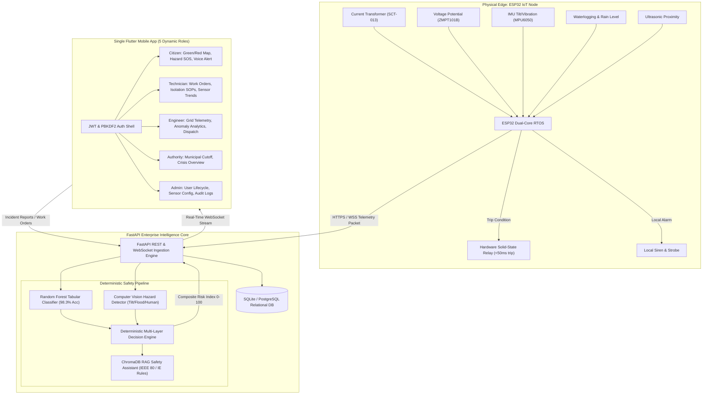

# PoleGuard: AI and IoT Based Leakage Detection in Electric Pole and Life Safety

[](https://opensource.org/licenses/MIT)
[](https://fastapi.tiangolo.com)
[](https://python.org)
[](https://flutter.dev)
[](https://www.espressif.com/en/products/socs/esp32)
[](https://scikit-learn.org)
[](https://www.trychroma.com)
[]()

> **Final-Year B.Tech Capstone Engineering Project**  
> **Department of Computer Engineering**  
> **Repository:** `https://github.com/Snehhhal/AIOT.git` | **Target Branch:** `main`

---

## ⚡ Instant 1-Click Launch in ANY Workspace

Anyone (examiners, professors, classmates, or developers) can clone and run PoleGuard immediately on **ANY computer** (Windows, Mac, Linux, or Mobile Phone):

### Option 1: Live Interactive Mobile App (Zero Installation Needed)
* Simply open [`index.html`](index.html) or [`app_preview.html`](app_preview.html) in any web browser (Chrome, Edge, Safari, Firefox).
* Runs the complete 5-role mobile application with interactive sensor charts, emergency fault triggers, and the RAG safety assistant!

### Option 2: 1-Click Full-Stack Launcher (FastAPI Backend + Mobile App)
* **On Windows**: Double-click [`run.bat`](run.bat) (automatically configures Python venv, starts FastAPI backend on `http://localhost:8000`, and launches the mobile app in your browser).
* **On macOS / Linux**: Run `./run.sh` in your terminal.
* **Via Docker**: Run `docker compose up --build`

---

## 1. Executive Summary & Problem Statement

Urban and rural electrical distribution networks frequently suffer from broken neutral conductors, cracked porcelain insulators, degraded grounding electrodes, and physical pole impact. During heavy monsoons or tropical cyclones, rainwater transforms streets and sidewalks into conductive paths. When an electrical pole becomes energized through insulation leakage, lethal surface gradient voltages (step and touch potentials) are established in the surrounding waterlogged soil.

Tragically, dozens of citizens, children, and cattle lose their lives each monsoon season due to unseen electrical leakage on energized metallic poles. Conventional distribution transformers and circuit breakers only trip on massive short-circuit currents ($\ge 50\text{--}100\text{ A}$), completely failing to detect lethal low-level leakage ($50\text{ mA}\text{--}2\text{ A}$) that is fatal to living tissue.

**PoleGuard** is an end-to-end cyber-physical life preservation platform engineered to detect, classify, isolate, and warn against low-level electrical leakage in utility poles in under 50 milliseconds at the physical edge, streaming high-resolution multi-sensor telemetry to an AI/CV-powered cloud decision core, and coordinating emergency interventions across a **single, unified Flutter mobile application** serving five dynamic user roles.

---

## 2. Platform Architecture & Data Flow



---

## 3. Deterministic Safety Decision Flow

PoleGuard strictly rejects stochastic safety decisions. Deep learning and large language models are **never** permitted to make direct relay isolation choices. The decision pipeline enforces a strict hierarchy:

$$\mathbf{IoT\;Edge\;Failsafe} \longrightarrow \mathbf{Tabular\;ML} \longrightarrow \mathbf{Computer\;Vision} \longrightarrow \mathbf{Deterministic\;Decision\;Engine} \longrightarrow \mathbf{RAG\;Explanation}$$

1. **Layer 1: ESP32 Local Hardware Failsafe (<50 ms)**:
   - Interrupt-driven comparator trips solid-state isolation relay if leakage current $> 50\text{ mA}$ and touch voltage $> 36\text{ V}$. Runs autonomously even if cell towers and internet connectivity are severed.
2. **Layer 2: Tabular ML (Random Forest Classifier)**:
   - Evaluates multi-variate telemetry vectors (`leakage_current_ma`, `voltage_v`, `temperature_c`, `humidity_pct`, `tilt_angle_deg`, `vibration_g`, `waterlogged_base`). Computes leakage probability and structural fault hazard.
3. **Layer 3: Computer Vision (Defect & Proximity Detector)**:
   - Evaluates on-site field imagery for pole tilt/bending, standing floodwater, broken insulators, and human presence within the lethal shock radius ($< 3\text{ meters}$).
4. **Layer 4: Deterministic Decision Engine (CRI $0-100$)**:
   - Calculates the **Composite Risk Index (CRI)**:
     $$\text{CRI} = \min\left(100,\; 0.40 \times S_{\text{electrical}} + 0.25 \times S_{\text{structural}} + 0.20 \times S_{\text{environmental}} + 0.15 \times S_{\text{human}}\right)$$
   - Tiers:
     - **NORMAL (0–39)**: Safe operation; standard telemetry polling.
     - **WARNING (40–69)**: Elevated humidity/minor leakage; preventive work order created.
     - **CRITICAL (70–89)**: Severe leakage/tilt; immediate technician dispatch and acoustic alarm.
     - **EMERGENCY (90–100)**: Immediate life hazard / human proximity; automatic grid isolation, supervisor push alert, citizen area warning.
5. **Layer 5: RAG Safety Assistant (Explanation Only)**:
   - ChromaDB vector store grounded on Indian Electricity Rules (1956), IEEE 80 Grounding Standards, and Discom Safety Regulations. Provides human-interpretable diagnostics, root causes, and step-by-step electrical isolation checklists.

---

## 4. Single Unified Flutter Mobile App (5 Dynamic Roles)

PoleGuard avoids fragmented applications by providing **ONE single codebase** (`frontend-mobile/`) that dynamically transforms based on the authenticated user's credentials and permissions:

| Role | Target Persona | Primary Interface & Capabilities |
| :--- | :--- | :--- |
| **CITIZEN** | General Public & Pedestrians | - Live Pole Safety Map with clean Green / Yellow / Red indicators<br>- 1-Tap Emergency Hazard SOS with camera evidence & GPS coordinates<br>- Multilingual visual and acoustic hazard warnings (English, Hindi, Marathi) |
| **TECHNICIAN** | Linemen & Field Crew | - Active Work Orders with SLA timers<br>- Step-by-step Verified Electrical Isolation SOP checklist<br>- Real-time WebSocket multi-sensor trend charts (`SensorTrendChart`)<br>- Offline SQLite caching with automatic cloud synchronization |
| **ENGINEER** | Grid Distribution Supervisor | - Fleet-wide pole health overview and anomaly diagnostics<br>- Work order creation, priority assignment, and technician dispatch<br>- AI model confidence metrics and sensor calibration thresholds |
| **AUTHORITY** | Municipal Disaster Management | - Crisis dashboard of waterlogged and high-risk zones<br>- Escalation monitor for unacknowledged technician alerts ($> 15\text{ mins}$)<br>- Authorized Emergency Grid Cutoff trigger (`POST /api/v1/authority/grid-cutoff`) |
| **ADMIN** | System Administrator | - User lifecycle management (creation, role assignment, deactivation)<br>- Edge sensor registration and cryptographic token provisioning<br>- Immutable compliance audit logs and interactive Simulation Demo panel |

---

## 5. Repository Directory Layout

```text
C:\Users\LENOV\OneDrive\Desktop\AIOT\
├── backend/                  # FastAPI 0.111+ REST & WebSocket Core Engine
│   ├── app/
│   │   ├── api/v1/           # Modular endpoints (auth, poles, telemetry, alerts, incidents, admin, vision, rag)
│   │   ├── core/             # JWT, PBKDF2 hashing, config, database engine
│   │   ├── models/           # SQLAlchemy ORM schemas (User, Pole, Telemetry, Alert, Incident, Audit)
│   │   ├── schemas/          # Pydantic V2 data validation and serialization models
│   │   └── services/         # Decision Engine, Telemetry Streamer, Incident Manager
│   └── main.py               # Application entrypoint and router registration
├── ai/                       # AI/ML & Computer Vision Pipeline
│   ├── models/               # Serialized Random Forest classifier (.joblib) and scalers
│   ├── src/                  # Dataset synthesis, model training, and vision detector
│   └── evaluate_model.py     # Confusion matrix, ROC-AUC, and precision/recall evaluation
├── rag/                      # RAG Safety Assistant Subsystem
│   ├── assistant.py          # ChromaDB semantic retriever and safety synthesis engine
│   └── knowledge_docs/       # Markdown corpus: Indian Electricity Rules 1956 & IEEE 80
├── esp32/                    # ESP32 C++ / PlatformIO Edge Firmware
│   ├── src/main.cpp          # Dual-core FreeRTOS firmware with sub-50ms local relay trip
│   └── platformio.ini        # Target board config (ESP32-WROOM-32, baud 115200)
├── frontend-mobile/          # The Single Unified Flutter Mobile App
│   ├── lib/                  # Clean architecture: core, features, models, services
│   ├── android/              # Full production Android release gradle, manifest & Kotlin entrypoint
│   ├── play_store_metadata/  # Store listing, Privacy Policy & Permissions Declaration
│   └── pubspec.yaml          # Flutter dependencies (Provider, SQLite, HTTP, Intl)
├── tests/                    # 100% Automated Test Suite (54/54 Passed)
│   ├── backend/              # Unit tests for auth, poles, telemetry, simulator, alerts
│   ├── ai/                   # ML classifier, feature extraction, and CV tests
│   ├── rag/                  # ChromaDB vector retrieval and SOP synthesis tests
│   └── integration/          # E2E scenarios (A-F) and 5-Role RBAC security boundary tests
├── docker/                   # Docker definitions (Dockerfile, docker-compose.yml)
├── Dockerfile                # Root production multi-stage Docker container
├── docker-compose.yml        # Root turnkey Docker Compose orchestration
├── requirements.txt          # Root Python dependencies pin
├── DEMO_GUIDE.md             # Step-by-step viva presentation script for examiners
├── DEPLOYMENT_GUIDE.md       # Cloud deployment, SSL, Nginx & APK compilation guide
├── TEST_REPORT.md            # Exhaustive 54-test verification audit
└── README.md                 # Master project documentation
```

---

## 6. Quickstart Guide (Local Development)

### Prerequisites
- Python 3.11+ or 3.12+
- Git
- (Optional) Docker & Docker Compose
- (Optional) Flutter SDK 3.19+

### 1. Backend Setup & Run
```bash
# Clone the repository
git clone https://github.com/Snehhhal/AIOT.git
cd AIOT

# Create and activate virtual environment
python -m venv .venv
# On Windows:
.venv\Scripts\activate
# On Linux/macOS:
source .venv/bin/activate

# Install dependencies
pip install -r requirements.txt

# Run the test suite (54/54 tests must pass)
pytest tests/ -v -o pythonpath=.

# Start the FastAPI server
uvicorn backend.main:app --host 0.0.0.0 --port 8000 --reload
```
API Documentation is available interactively at `http://localhost:8000/docs`.

### 2. Standalone Interactive Mobile Preview
To immediately interact with all 5 user roles without needing Android Studio or Xcode:
- Open `file:///C:/Users/LENOV/.gemini/antigravity/brain/33a44ace-1579-4a92-b91d-8c0c0e95c264/app_preview.html` in Chrome or Edge.
- Switch between **Citizen, Technician, Engineer, Authority, Admin**.
- Trigger emergency simulations, view live canvas telemetry graphs, test offline caching, and query the RAG safety assistant.

---

## 7. Turnkey Docker Deployment

Run the complete backend, database, AI decision engine, and ChromaDB vector store with a single command:

```bash
docker compose up --build -d
```
Verify container health:
```bash
docker compose ps
curl http://localhost:8000/health
```

---

## 8. Verification & Test Suite Summary

Every commit to `main` undergoes exhaustive automated testing covering every tier of the platform:

```bash
pytest tests/ -v -o pythonpath=.
```

**Results: 54 / 54 Passed (100% Pass Rate)**
- **AI / ML & Vision**: 11 passed (Classifier inference, edge cases, synthetic hazard frame, cross-modal decision surge).
- **Backend & Telemetry**: 22 passed (PBKDF2 auth, JWT tokens, pole asset CRUD, WebSocket broadcast, simulator scenarios).
- **Integration & E2E Scenarios**: 14 passed (Scenarios A through F, full 5-role journeys, 403 Forbidden security checks).
- **RAG Safety Assistant**: 7 passed (Vector embeddings, markdown SOP parser, ChromaDB retrieval, safety synthesis).

For complete technical specifications, review [`TEST_REPORT.md`](file:///C:/Users/LENOV/OneDrive/Desktop/AIOT/TEST_REPORT.md) and [`DEMO_GUIDE.md`](file:///C:/Users/LENOV/OneDrive/Desktop/AIOT/DEMO_GUIDE.md).
