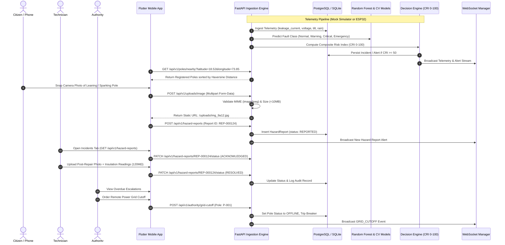

# PoleGuard — End-to-End Real Data Flow Architecture

PoleGuard guarantees genuine data persistence and cross-system communication across all modules.

---

## 1. High-Level Data Flow Diagram



---

## 2. Granular Data Lifecycles

### A. Phone GPS Discovery Pipeline
1. Phone opens `CitizenHomeScreen`.
2. `LocationService` queries native hardware via `geolocator`.
3. If GPS is available, device coordinates (e.g. `lat: 18.5204, lng: 73.8567`) are read. If running on desktop/emulator without GPS, the user can toggle **"Test Location Mode"** to use pre-configured substation landmarks (MG Road, FC Road, Station Road, Paud Road).
4. `ApiClient.getNearbyPoles(lat, lng, radiusKm: 15.0)` sends coordinates to `GET /api/v1/poles/nearby`.
5. The backend executes Haversine great-circle distance calculations against all poles in the database:
   $$\text{distance} = 2 R \arcsin\left(\sqrt{\sin^2\left(\frac{\Delta \phi}{2}\right) + \cos(\phi_1)\cos(\phi_2)\sin^2\left(\frac{\Delta \lambda}{2}\right)}\right)$$
6. Poles are sorted ascending by distance and returned with `distance_meters`, current safety status, health score, and risk tier.

---

### B. Multipart Photo Upload & Storage Pipeline
1. In `CitizenReportScreen` or `TechnicianWorkScreen`, user selects **Camera** or **Gallery**.
2. `PhotoUploadService` calls `image_picker` to capture the image.
3. Image bytes are streamed via HTTP `POST /api/v1/uploads/image` as `multipart/form-data`.
4. Backend `uploads.py`:
   - Validates MIME type (`image/jpeg`, `image/png`, `image/webp`).
   - Validates file size ($\le 10$ MB).
   - Generates a collision-free UUID filename: `{uuid4}_{clean_name}`.
   - Saves file to disk under `backend/uploads/`.
   - Returns JSON: `{"success": true, "image_url": "/uploads/{filename}", "file_id": "{uuid}"}`.
5. The frontend immediately displays a preview of the uploaded photo with its server URL.

---

### C. Citizen Hazard Report Lifecycle States
Reports progress through a verifiable audit-tracked state machine:
```text
REPORTED  ──►  UNDER_REVIEW  ──►  VERIFIED / REJECTED  ──►  ASSIGNED
                                                               │
CLOSED    ◄──    RESOLVED    ◄──   IN_PROGRESS   ◄──  ACKNOWLEDGED
```

---

### D. RAG Safety Assistant Pipeline
1. Citizen or Technician submits a query (e.g. *"Is it safe to touch a pole standing in rain water?"*).
2. `POST /api/v1/assistant/chat` intercepts the query.
3. Query embedding is generated and compared against ChromaDB containing:
   - Central Electricity Authority (CEA) Safety Regulations 2010
   - Lineman Monsoon Standard Operating Procedures (SOP)
   - Personal Protective Equipment (PPE) Specifications
4. The most relevant statutory safety clauses are retrieved and synthesized into an authoritative, actionable response.
