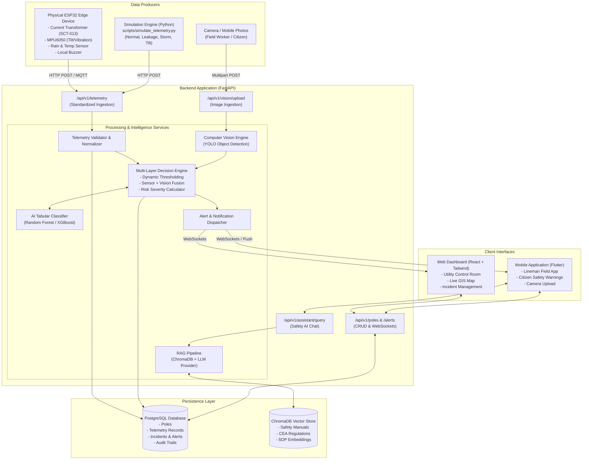

# System Architecture Document

## 1. Executive Summary

The **AI & IoT Based Leakage Detection in Electric Pole and Life Safety Platform** is an end-to-end cyber-physical safety network designed to detect electrical leakage on utility poles, evaluate real-time hazards via sensor fusion and computer vision, alert stakeholders, and guide emergency response through Retrieval-Augmented Generation (RAG).

---

## 2. High-Level System Architecture



---

## 3. Data Pipeline & End-to-End Flow

### Stage 1: Edge Sensing & Ingestion
1. **Physical Sensing:** The ESP32 continuously samples the Current Transformer at high frequency (1 kHz sampling, RMS calculated every 1 second). Concurrently, accelerometer (MPU6050) and rain sensor pins are polled.
2. **Standardized Transmission:** Every $N$ seconds (default 5s) or immediately upon abnormal threshold breach, an HTTP POST request is sent to `/api/v1/telemetry`.
3. **Hardware Agnostic Ingestion:** The endpoint accepts identical JSON schemas whether sent by a live ESP32 or the simulation script (`scripts/simulate_telemetry.py`).

### Stage 2: Ingestion & Validation
1. The FastAPI router validates payloads using Pydantic schemas (`TelemetryIn`).
2. Timestamps, pole ID registration, and sanity ranges are verified (e.g. current $\ge 0$, tilt $\le 90^\circ$).
3. The valid reading is stored asynchronously in PostgreSQL.

### Stage 3: Multi-Layer Decision Engine
The incoming telemetry passes through a 3-layer decision pipeline:
* **Layer 1: Rule-Based Deterministic Thresholds:**
  - Leakage Current $> 30\text{ mA}$ triggers immediate High Risk flag (international touch-safety threshold).
  - Tilt $> 15^\circ$ triggers structural damage warning.
* **Layer 2: AI ML Classification:**
  - Tabular features (`[current_ma, tilt_deg, vibration_g, humidity_pct, rain_detected]`) are evaluated by a pre-trained Random Forest/XGBoost classifier to predict risk class (`Normal`, `Advisory`, `High Risk`, `Critical Hazard`).
* **Layer 3: Computer Vision Cross-Validation:**
  - If field photos or pole surveillance streams are uploaded, YOLO detects physical context (e.g., standing water at base, human proximity within 2 meters).
  - Risk score is dynamically escalated if a human is in close proximity to a leaking pole in wet conditions.

### Stage 4: Alert Dispatch & Client Notification
1. If severity exceeds `Advisory`, an `Alert` record is generated in PostgreSQL.
2. The Alert is dispatched over WebSockets (`/ws/alerts`) to connected React dashboards.
3. Push notifications/SMS are queued for registered field linemen in the geographic sector.

### Stage 5: Safety Resolution via RAG Assistant
1. Linemen on-site open the mobile app or web console and interact with the AI assistant.
2. ChromaDB retrieves relevant articles from Indian Electricity Rules and utility SOPs.
3. The LLM generates structured, context-specific isolation and de-energization guidelines.

---

## 4. Operational Modes: Real Hardware vs. Simulation Mode

To support testing, academic demonstration, and field operations, the backend architecture features a runtime-switchable operating mode governed by `.env`:

```
SIMULATION_MODE=true  # or false
```

| Dimension | Real Hardware Mode (`SIMULATION_MODE=false`) | Simulation Mode (`SIMULATION_MODE=true`) |
| :--- | :--- | :--- |
| **Data Origin** | Physical ESP32 with CT, MPU6050, Rain sensors | Python script (`scripts/simulate_telemetry.py`) |
| **Connection Protocol** | Wi-Fi / GSM / LoRaWAN HTTP POST | Localhost HTTP POST |
| **Endpoint Used** | `POST /api/v1/telemetry` | `POST /api/v1/telemetry` (Identical!) |
| **Payload Schema** | `TelemetryIn` (JSON) | `TelemetryIn` (JSON) |
| **Database Handling** | Real pole records | Simulated demo poles (P-101 to P-105) |
| **AI / Decision Engine** | Real-time classification & vision checks | Identical real-time classification & vision checks |
| **Local Edge Alert** | ESP32 GPIO pin triggers buzzer & LED strobe | Simulated in script console output |

---

## 5. Non-Functional Requirements & Architecture Qualities

1. **Safety First (Fail-Safe):** If edge-to-cloud communication fails, the ESP32 contains local firmware thresholding to trigger the buzzer/relay without waiting for the server.
2. **Low Latency:** Ingestion to alert dispatch latency target: $< 500\text{ ms}$.
3. **Fault Tolerance:** Asynchronous PostgreSQL pooling (`asyncpg`) prevents ingestion bottlenecks during concurrent pole transmissions.
4. **Security & Data Privacy:** No secrets committed to the repository; JWT-based role authentication for administrative operations; sanitized vision storage.
