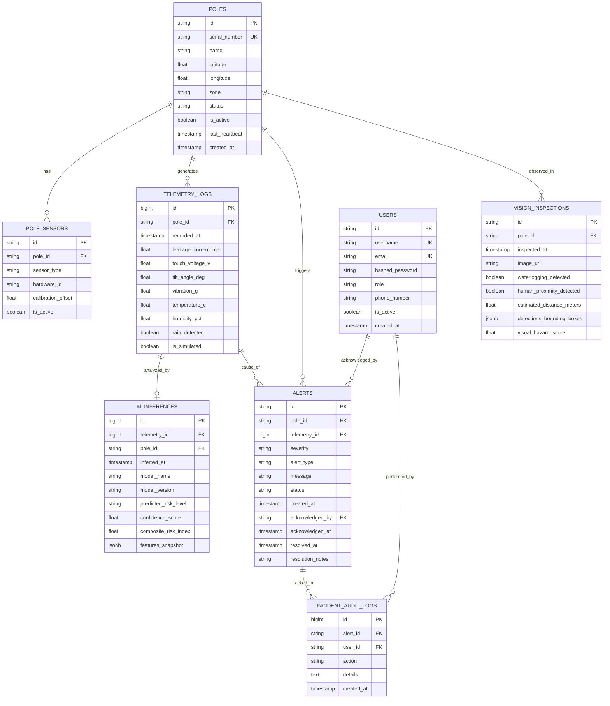

# Database Design & Schema Specifications

## 1. Overview

The storage layer uses **PostgreSQL** to manage spatial infrastructure records, high-frequency time-series telemetry, AI inference logs, incident lifecycles, and security audit trails.

---

## 2. Entity Relationship (ER) Diagram



---

## 3. Detailed Table Definitions

### 3.1 `poles`
Represents physical or simulated electric utility/street light poles.
* `id` (`VARCHAR(36)`, PK): Unique identifier (e.g., UUID or `POLE-101`).
* `serial_number` (`VARCHAR(64)`, Unique): Equipment asset barcode/serial.
* `name` (`VARCHAR(128)`): Friendly location name (e.g. `Junction 4 - MG Road`).
* `latitude` (`DOUBLE PRECISION`): WGS84 GPS latitude.
* `longitude` (`DOUBLE PRECISION`): WGS84 GPS longitude.
* `zone` (`VARCHAR(64)`): Municipal ward / electrical sub-division.
* `status` (`VARCHAR(32)`): Enum (`HEALTHY`, `WARNING`, `CRITICAL`, `OFFLINE`, `MAINTENANCE`).
* `is_active` (`BOOLEAN`): Administrative enable/disable toggle.
* `last_heartbeat` (`TIMESTAMP WITH TIME ZONE`): Last packet arrival time.
* `created_at` (`TIMESTAMP WITH TIME ZONE`): Record registration timestamp.

### 3.2 `telemetry_logs`
High-frequency sequential records emitted by ESP32 or simulation script.
* `id` (`BIGSERIAL`, PK): Incrementing identifier.
* `pole_id` (`VARCHAR(36)`, FK): Target pole reference.
* `recorded_at` (`TIMESTAMP WITH TIME ZONE`): Device or server reception timestamp.
* `leakage_current_ma` (`REAL`): Measured RMS leakage current in milli-Amperes ($0 - 500\text{ mA}$).
* `touch_voltage_v` (`REAL`): Estimated pole metallic surface potential in Volts ($0 - 250\text{ V}$).
* `tilt_angle_deg` (`REAL`): Deviation from vertical axis ($0^\circ - 90^\circ$).
* `vibration_g` (`REAL`): Peak acceleration amplitude in $g$.
* `temperature_c` (`REAL`): Ambient enclosure temperature in $^\circ\text{C}$.
* `humidity_pct` (`REAL`): Relative humidity percentage ($0 - 100\%$).
* `rain_detected` (`BOOLEAN`): Digital flag from rain sensor.
* `is_simulated` (`BOOLEAN`): True if generated via `scripts/simulate_telemetry.py`.

### 3.3 `ai_inferences`
Audit trail of predictions generated by machine learning models.
* `id` (`BIGSERIAL`, PK): Unique record identifier.
* `telemetry_id` (`BIGINT`, FK): Source telemetry entry.
* `pole_id` (`VARCHAR(36)`, FK): Associated pole.
* `inferred_at` (`TIMESTAMP WITH TIME ZONE`): Inference timestamp.
* `model_name` (`VARCHAR(64)`): Model architecture name (e.g., `RandomForestClassifier`).
* `model_version` (`VARCHAR(32)`): Model checkpoint version tag (e.g., `v1.0.0`).
* `predicted_risk_level` (`VARCHAR(32)`): Classified level (`NORMAL`, `ADVISORY`, `HIGH_RISK`, `CRITICAL`).
* `confidence_score` (`REAL`): Probability confidence of predicted class ($0.0 - 1.0$).
* `composite_risk_index` (`REAL`): Multi-factor normalized risk score ($0 - 100$).
* `features_snapshot` (`JSONB`): Key-value pair of normalized input features.

### 3.4 `vision_inspections`
Computer vision inferences evaluated by YOLO from camera uploads.
* `id` (`VARCHAR(36)`, PK): UUID.
* `pole_id` (`VARCHAR(36)`, FK): Inspected pole.
* `inspected_at` (`TIMESTAMP WITH TIME ZONE`): Frame capture timestamp.
* `image_url` (`TEXT`): Storage path of processed image.
* `waterlogging_detected` (`BOOLEAN`): True if water puddling detected around base.
* `human_proximity_detected` (`BOOLEAN`): True if person detected within proximity perimeter.
* `estimated_distance_meters` (`REAL`): Distance between nearest human and pole base.
* `detections_bounding_boxes` (`JSONB`): YOLO bounding boxes `[class, confidence, x1, y1, x2, y2]`.
* `visual_hazard_score` (`REAL`): Visual risk component ($0 - 1.0$).

### 3.5 `alerts`
Actionable incidents requiring notifications, lineman dispatch, or utility intervention.
* `id` (`VARCHAR(36)`, PK): UUID.
* `pole_id` (`VARCHAR(36)`, FK): Pole in alarm.
* `telemetry_id` (`BIGINT`, FK, Nullable): Triggering telemetry record.
* `severity` (`VARCHAR(16)`): Enum (`LOW`, `MEDIUM`, `HIGH`, `CRITICAL`).
* `alert_type` (`VARCHAR(64)`): E.g., `CURRENT_LEAKAGE`, `POLE_TILT`, `WATERLOG_PROXIMITY`.
* `message` (`TEXT`): Human-readable notification text.
* `status` (`VARCHAR(32)`): Enum (`NEW`, `ACKNOWLEDGED`, `IN_PROGRESS`, `RESOLVED`).
* `created_at` (`TIMESTAMP WITH TIME ZONE`): Alarm trigger time.
* `acknowledged_by` (`VARCHAR(36)`, FK, Nullable): User ID who acknowledged.
* `acknowledged_at` (`TIMESTAMP WITH TIME ZONE`, Nullable): Acknowledgment timestamp.
* `resolved_at` (`TIMESTAMP WITH TIME ZONE`, Nullable): Resolution timestamp.
* `resolution_notes` (`TEXT`, Nullable): Description of corrective field action.

### 3.6 `users`
System accounts for technicians, control room admins, and safety managers.
* `id` (`VARCHAR(36)`, PK): UUID.
* `username` (`VARCHAR(64)`, Unique): Login username.
* `email` (`VARCHAR(128)`, Unique): Contact email.
* `hashed_password` (`VARCHAR(256)`): Argon2 or bcrypt password hash.
* `role` (`VARCHAR(32)`): Enum (`ADMIN`, `LINEMAN`, `SUPERVISOR`, `CITIZEN`).
* `phone_number` (`VARCHAR(20)`): Contact number for SMS dispatch.
* `is_active` (`BOOLEAN`): Account active flag.
* `created_at` (`TIMESTAMP WITH TIME ZONE`): Registration timestamp.

### 3.7 `incident_audit_logs`
Immutable compliance log of actions taken during an incident.
* `id` (`BIGSERIAL`, PK): Sequence number.
* `alert_id` (`VARCHAR(36)`, FK): Target alert.
* `user_id` (`VARCHAR(36)`, FK): Acting user.
* `action` (`VARCHAR(64)`): Action tag (e.g. `ACKNOWLEDGED`, `DISPATCHED_LINEMAN`, `DE_ENERGIZED`).
* `details` (`TEXT`): Additional audit notes.
* `created_at` (`TIMESTAMP WITH TIME ZONE`): Action timestamp.

---

## 4. Indexing & Optimization Strategy

1. **Time-Series Querying:**
   ```sql
   CREATE INDEX idx_telemetry_pole_time ON telemetry_logs (pole_id, recorded_at DESC);
   CREATE INDEX idx_telemetry_recorded_at ON telemetry_logs (recorded_at DESC);
   ```
2. **Active Alert Lookups:**
   ```sql
   CREATE INDEX idx_alerts_active ON alerts (status, severity) WHERE status != 'RESOLVED';
   CREATE INDEX idx_alerts_pole ON alerts (pole_id, created_at DESC);
   ```
3. **Geo-Spatial Radius Queries (PostGIS-ready):**
   ```sql
   CREATE INDEX idx_poles_lat_lng ON poles (latitude, longitude);
   ```
4. **Data Retention & Partitioning:**
   - In production, `telemetry_logs` should be range-partitioned by month (`PARTITION BY RANGE (recorded_at)`).
   - Telemetry older than 90 days can be aggregated into hourly averages and archived to cold storage to preserve storage space.
