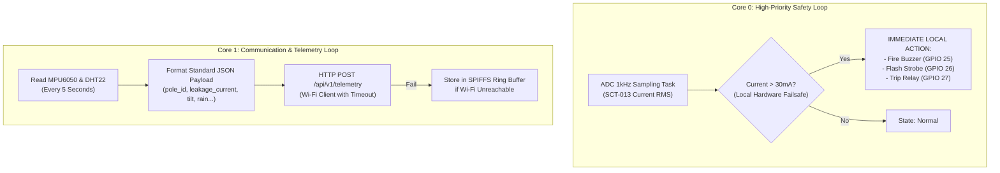

# IoT & Embedded Systems Design (ESP32)

## 1. Hardware Architecture & Component Selection

```
                         +-----------------------------------+
                         |         ESP32-WROOM-32D           |
                         |  (Dual-Core 240MHz, 520KB SRAM)   |
                         +-----------------------------------+
                                   |         |        |
         +-------------------------+         |        +-------------------------+
         |                                   |                                  |
         v (Analog / I2C)                    v (Digital GPIO)                   v (Actuators)
+-------------------------+        +--------------------+            +--------------------+
| Sensors:                |        | Network Transceivers|           | Failsafe Outputs:  |
| - SCT-013 Current Trans.|        | - Onboard 2.4GHz   |           | - Active 5V Buzzer |
|   (GPIO 34 - ADC1_CH6)  |        |   Wi-Fi (802.11bgn)|           |   (GPIO 25)        |
| - MPU6050 Tilt/Vibr.    |        | - GSM SIM800L /    |           | - High-Power RED   |
|   (I2C: SDA=21, SCL=22) |        |   LoRa (Optional)  |           |   Warning Strobe   |
| - Rain Sensor (FC-37)   |        +--------------------+           |   (GPIO 26)        |
|   (Digital GPIO 19)     |                                         | - Isolation Relay  |
| - DHT22 Temp/Humidity   |                                         |   (GPIO 27)        |
|   (Digital GPIO 4)      |                                         +--------------------+
+-------------------------+
```

---

## 2. Sensor Interfacing & Electrical Details

### 2.1 Current Transformer (SCT-013-000)
* **Principle:** Non-invasive AC current sensing via inductive coupling clamped around the pole ground conductor.
* **Conditioning Circuit:**
  - Burden resistor ($R_B = 33\,\Omega$) converts secondary current into voltage.
  - DC bias voltage divider ($2 \times 10\,\text{k}\Omega$ resistors connected to $3.3\,\text{V}$ and GND, decoupled with a $10\,\mu\text{F}$ capacitor) offsets the sinusoidal signal to $+1.65\,\text{V}$ to operate safely within the ESP32 $0 - 3.3\,\text{V}$ ADC range.
* **Sampling Rate:** $1.0\,\text{kHz}$ sampling across $50\,\text{Hz}$ mains cycles ($20\,\text{ms}$ period = 20 samples per cycle, averaged over 50 cycles = 1 second window).
* **RMS Calculation Formula:**
  $$I_{\text{RMS}} = \sqrt{\frac{1}{N} \sum_{i=1}^N \left(I_i - I_{\text{mid}}\right)^2} \times \text{Calibration Factor}$$

### 2.2 Tilt & Vibration Sensor (MPU6050)
* **Interface:** I2C bus ($400\,\text{kHz}$ Fast Mode) on GPIO 21 (SDA) and GPIO 22 (SCL).
* **Tilt Angle Calculation:**
  $$\theta_{\text{tilt}} = \arccos\left(\frac{a_z}{\sqrt{a_x^2 + a_y^2 + a_z^2}}\right) \times \frac{180^\circ}{\pi}$$
* **Vibration RMS:** Root sum squared of high-pass filtered accelerometer data across axes $a_x, a_y, a_z$.

### 2.3 Rain & Moisture Detection (FC-37 / Rain Board)
* **Sensor Pins:** Digital Output (DO) on GPIO 19.
* **Sensitivity:** Triggers `true` on surface condensation or active rainfall.

### 2.4 Temperature & Relative Humidity (DHT22)
* **Interface:** Single-bus digital signal on GPIO 4 with $4.7\,\text{k}\Omega$ pull-up resistor.

---

## 3. Firmware Architecture (FreeRTOS Multitasking)



---

## 4. Local Edge Failsafe Principle (Zero Cloud Dependency)

A fundamental design constraint is **life safety cannot depend on an Internet connection**:
* If the measured leakage current exceeds the fatal threshold ($30\,\text{mA}$ touch current or $50\,\text{V}$ touch potential), the firmware activates local auditory and visual alerts immediately ($< 10\,\text{ms}$ delay) directly in the hardware loop.
* The device does not wait for a cloud HTTP response before protecting nearby pedestrians.

---

## 5. Telemetry Transmission Packet Specification

The ESP32 constructs and dispatches the following JSON payload every 5 seconds to `http://<backend-host>:8000/api/v1/telemetry`:

```json
{
  "pole_id": "POLE-ESP32-01",
  "leakage_current_ma": 34.8,
  "touch_voltage_v": 52.1,
  "tilt_angle_deg": 1.8,
  "vibration_g": 0.04,
  "temperature_c": 31.2,
  "humidity_pct": 92.5,
  "rain_detected": true,
  "is_simulated": false
}
```

---

## 6. Power Supply & Enclosure

* **Primary Supply:** $12\,\text{V}$ step-down supply connected to municipal street lighting feeder line.
* **Secondary / Backup Supply:** $3.2\,\text{V} / 6000\,\text{mAh}$ $\text{LiFePO}_4$ battery with integrated TP5000 charge controller and a compact $5\,\text{W}$ solar panel mounted atop the pole.
* **Enclosure:** NEMA 4X / IP65 waterproof polymer enclosure with weatherproof cable glands.
