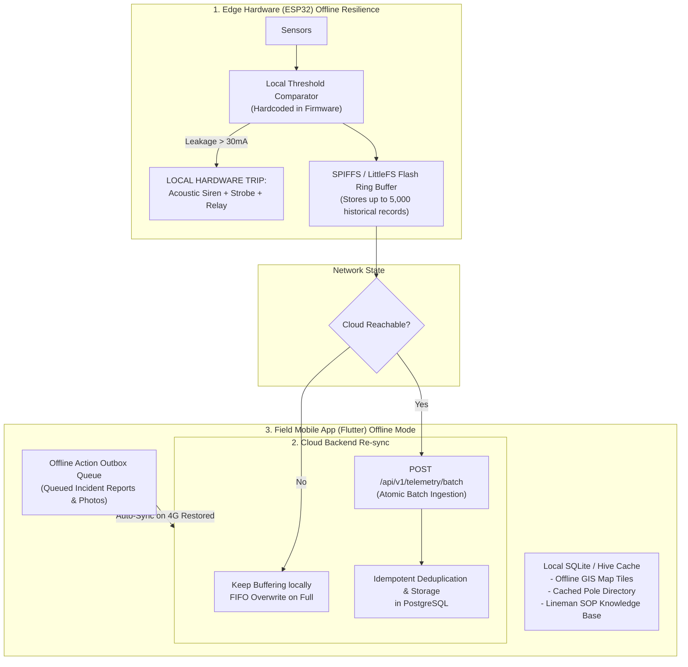

# Offline Mode & Resilience Strategy

## 1. Context & Motivation

Severe weather events that create severe electrical leakage hazards—monsoons, flash floods, falling branches, and cyclones—are the exact scenarios most likely to disable cellular towers, cut fiber lines, or overload utility communication channels.

A life-safety system must continue protecting humans and capturing data even during **complete network blackout**.

---

## 2. Multi-Tier Offline Architecture

---

## 3. Tier 1: Hardware Edge (ESP32) Autonomous Protection

### 3.1 Unconditional Edge Tripping
* **Zero Network Dependency:** The threshold evaluation loop runs on FreeRTOS Core 0 independent of network tasks.
* If RMS current exceeds $30\,\text{mA}$, the ESP32 fires GPIO 25 (Buzzer) and GPIO 27 (Relay Trip) within $10\,\text{ms}$, without waiting for server authorization.

### 3.2 Flash Telemetry Ring Buffer
* When HTTP POST requests to `/api/v1/telemetry` timeout (3 successive failures):
  1. Firmware enters `OFFLINE_LOGGING` state.
  2. Telemetry records are written sequentially to a circular binary file in **LittleFS** flash memory.
  3. Capacity: $2\,\text{MB}$ allocated flash holds $> 5,000$ structured records ($\approx 7\text{ hours}$ of continuous $5\text{s}$ sampling).
  4. On network restoration, the buffer drains via `POST /api/v1/telemetry/batch` in chunks of 50 records.

---

## 4. Tier 2: Mobile Application (Flutter) Offline Capabilities

1. **Local SQLite / Hive Storage:**
   - Caches the full geographical pole directory and hazard status of the lineman’s assigned municipal zone.
   - Saves vector embeddings or markdown copies of critical emergency safety SOPs locally on the phone so the lineman can read isolation guidelines without internet.
2. **Offline GIS Map Tile Caching:**
   - Vector map tiles for the operational sector are pre-downloaded and stored in local cache.
3. **Outbox Pattern for Field Incident Reports:**
   - If a lineman logs a pole inspection, takes an on-site photo, or marks a hazard while offline:
     1. The action is stored in the local SQLite `pending_sync_queue`.
     2. A background synchronization worker detects connectivity restoration and posts the payload.

---

## 5. Tier 3: Backend Ingestion & Deduplication

### 5.1 Batch Ingestion Endpoint
* `POST /api/v1/telemetry/batch` handles compressed arrays of historical readings uploaded by reconnected devices.

### 5.2 Idempotency Guarantee
* PostgreSQL table `telemetry_logs` enforces uniqueness on `(pole_id, recorded_at)`.
* Ingestion queries use `ON CONFLICT (pole_id, recorded_at) DO NOTHING` to prevent duplicate telemetry records when re-transmissions occur.
