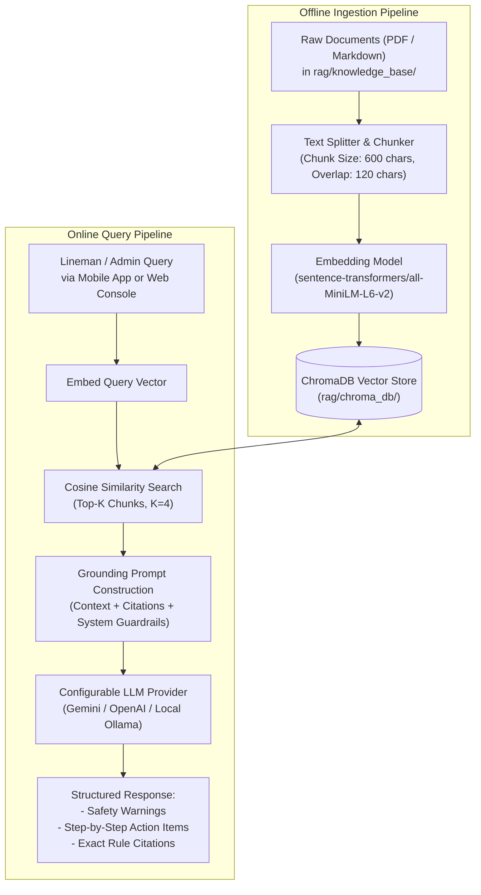

# Retrieval-Augmented Generation (RAG) Safety Assistant Design

## 1. Overview & Objective

Field linemen, municipal supervisors, and control-room operators require immediate access to standardized safety operating procedures (SOPs), statutory electricity regulations, and emergency handling protocols when dealing with active electrical hazards.

The **RAG Safety Assistant** grounds an LLM in verified electrical safety manuals and regulations stored in a local vector database (**ChromaDB**), eliminating hallucinations and providing step-by-step field guidance with exact rule citations.

---

## 2. Knowledge Base Scope & Document Corpus

The initial knowledge base in `rag/knowledge_base/` comprises four key domains:

1. **Statutory Electrical Regulations:**
   - *Central Electricity Authority (Measures relating to Safety and Electric Supply) Regulations, 2010* (Regulations 41, 42, 43 on grounding, earthing continuity, and isolation).
   - *Indian Electricity Rules (IE Rules 1956)* (Rule 61: Connection with earth, Rule 88: Guarding of overhead lines).
2. **Distribution Utility Field SOPs:**
   - Monsoon Preparedness and Emergency Isolation Standard Operating Procedures.
   - Street Light & Distribution Pole Earthing Verification Protocols.
3. **Lineman Safety & Personal Protective Equipment (PPE):**
   - Specifications for Class 0 (1000V) dielectric gloves, arc-flash face shields, and insulated discharge rods.
   - De-energization verification procedures using two-pole and non-contact voltage testers.
4. **Emergency First-Aid & Step-Potential Guidelines:**
   - Protocols for safely approaching a person in a waterlogged electrified perimeter (shuffling feet method to prevent step-potential gradient shock).
   - Cardiopulmonary resuscitation (CPR) for electrical shock victims.

---

## 3. RAG Architecture & Processing Pipeline



---

## 4. Chunking & Vector Store Configurations

* **Embedding Model:** `sentence-transformers/all-MiniLM-L6-v2` (384-dimensional vector, fast CPU inference, lightweight memory footprint).
* **Chunking Strategy:** Recursive Character Text Splitter:
  - `chunk_size`: 600 characters
  - `chunk_overlap`: 120 characters (ensuring continuity of technical terms and rule numbers).
* **Vector Store:** **ChromaDB** in persistent disk mode (`rag/chroma_db/`).
* **Metadata Tracked per Chunk:**
  ```json
  {
    "source_document": "CEA_Safety_Regulations_2010.pdf",
    "regulation_number": "Regulation 43",
    "topic": "Earthing and Isolation",
    "jurisdiction": "National / Distribution Utility"
  }
  ```

---

## 5. System Prompt & Guardrails

To ensure safety-critical precision, the LLM prompt enforces strict boundary constraints:

```text
You are an expert electrical safety AI assistant for municipal and utility field personnel.
You provide life-critical advice regarding electrical leakage, pole maintenance, and shock hazards.

STRICT SAFETY RULES:
1. ALWAYS prioritize human life safety first. If waterlogging and high current are present, command the user NOT to make physical contact.
2. Base your response EXCLUSIVELY on the provided retrieved context. DO NOT fabricate safety guidelines or make assumptions.
3. List PPE requirements (gloves rating, boots, discharge rods) before any physical contact steps.
4. Always cite the exact regulation or SOP title and section provided in the context.
5. If the provided context does not contain sufficient information to safely answer the question, state: "Insufficient certified safety data available. Immediately contact the central distribution control room for a manual feeder shutdown."
```

---

## 6. Adapter Pattern for Configurable LLM Providers

The RAG service utilizes a provider-agnostic interface:
* **`gemini` (Default):** High-speed API inference with broad context windows.
* **`openai`:** Compatible with GPT-4o / GPT-4o-mini.
* **`ollama` / `local`:** On-premise offline inference using quantized Llama 3 or Mistral for field networks lacking internet connectivity.
